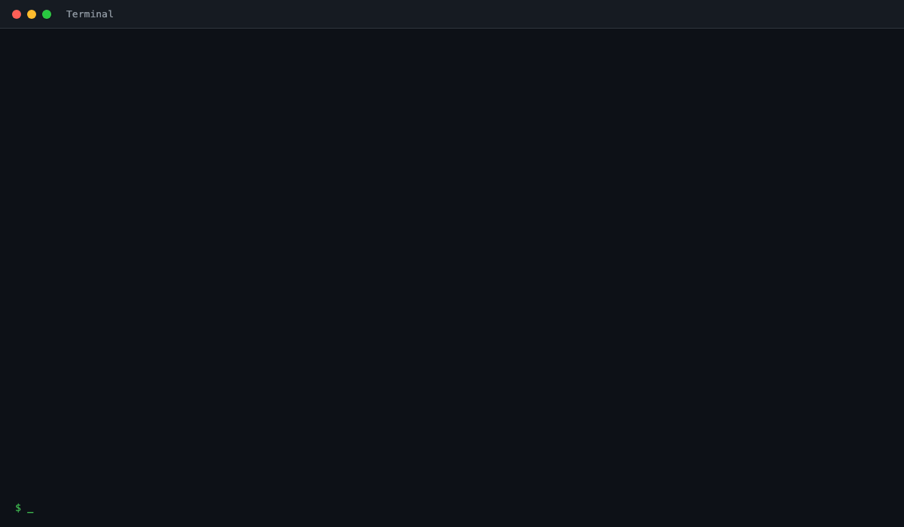

# Quin Agent Scanner

> Nothing in your codebase is hidden from Quin.

[](LICENSE)
[](https://www.python.org/downloads/)

Named after [Bao Qingtian](https://gaincontrol.ai/about) -- the incorruptible judge of the Song Dynasty who saw through every deception -- **Quin** is an open-source CLI tool by [Gaincontrol](https://gaincontrol.ai/) that scans any codebase to detect AI agents, extract system prompts, classify risk, and produce compliance-ready reports.

Point Quin at a repo and get back: every AI agent, what it does, what tools it has, and what risks it carries -- in a single HTML report.

Learn more at [gaincontrol.ai/quin](https://gaincontrol.ai/quin).

> **Note:** This is version **1.0.0rc2**, the current release candidate for 1.0. The interfaces in the [stability policy](docs/stability.md) are frozen; `1.0.0` follows after a soak period without contract changes. Scan results are provided **as-is** and may be incomplete, inaccurate, or contain false positives/negatives. **Always review and validate findings independently before making security, compliance, or architectural decisions based on them.** The authors and contributors of Quin accept no responsibility or liability for any actions taken, or not taken, based on the output of this tool. If you encounter any issues, please [open an issue](https://github.com/Gaincontrol-Pte-Ltd/quin-agent-scanner/issues) or email us at [pixiedust@gaincontrol.ai](mailto:pixiedust@gaincontrol.ai) -- your feedback helps us improve the scanner.

---

## About Gaincontrol

Quin is built by [Gaincontrol](https://gaincontrol.ai/), headquartered in Singapore. We build the infrastructure enterprises need to run AI agents safely.

| Product | What it does |
|---|---|
| **[Quin](https://gaincontrol.ai/quin)** | AI Agent Scanner -- see every agent, trust nothing blindly |
| **[Zino](https://gaincontrol.ai/)** | AI Identity Governance -- every agent operates only within its granted authority |
| **[Drona](https://gaincontrol.ai/)** | Safe Execution Fabric -- deterministic execution for probabilistic AI |

- **Website:** [gaincontrol.ai](https://gaincontrol.ai/)
- **Contact:** [pixiedust@gaincontrol.ai](mailto:pixiedust@gaincontrol.ai)

---

## Quin Feature Overview

Quin maps the AI and agent components present in a repository, preserves the evidence behind each detection, and produces reports that can be reviewed locally or used in CI.

| Capability | What Quin discovers or reports |
|---|---|
| **Repository scanning** | Local directories, GitHub repositories and organizations, Azure DevOps repositories, and target lists. Scan a selected GitHub branch; run single-repository, batch, organization, or CI scans. |
| **AI framework and dependency discovery** | AI SDKs and agent frameworks, model providers and model IDs, vector databases, embedding packages, and voice or image AI dependencies. See [Supported Frameworks](#supported-frameworks). |
| **Agent and prompt discovery** | Named agents and agent configurations, system prompts, prompt templates, agent skills, and related source files. |
| **Tools and MCP discovery** | Tool definitions, external-service usage, MCP servers and transports, and tool usage evidence. Quin can link detected agents to tools explicitly listed in supported Python `tools=[...]` calls and JavaScript/TypeScript agent objects. It records both source locations when it also detects the tool definition. |
| **Skill security analysis** | Agent Skills (`SKILL.md` packages for Claude Code, Codex and OpenCode), MCP tool definitions, and agent instruction files (`CLAUDE.md`, `AGENTS.md`, `GEMINI.md`, Cursor, Windsurf, Cline, Roo and Copilot rules, checked with the text rules only). Quin scores each skill 0–100 (SAFE / CAUTION / HIGH_RISK) using static rules for prompt injection, hidden content, exfiltration, dangerous code, supply chain, excessive permissions and MCP tool poisoning. With an LLM enabled, findings are also confirmed or disputed. See [Skill rules](docs/skill-rules.md). |
| **Model endpoint discovery** | Model usage by provider, model, source, and role; LLM endpoint addresses and endpoint types. Credentials in endpoint URLs and expressions are redacted. |
| **Infrastructure and delivery discovery** | Infrastructure-as-code, Dockerfiles, Jupyter notebooks, and CI pipelines related to AI applications. |
| **Complete finding inventory** | All raw scanner observations, including observations that are deduplicated in the summary artifact list or omitted from the LLM context to keep synthesis bounded. |
| **Scan coverage** | Files discovered, indexed, excluded as vendor/generated, read successfully or unsuccessfully, and scanners enabled, completed, or returning findings. |
| **Risk and vulnerability analysis** | Optional two-pass LLM system classification and agent synthesis, taxonomy-grounded risk signals with evidence references, and OSV.dev checks for detected framework versions. Optional web search can supplement vulnerability lookup. |
| **Zino governance detection** | Optional detection of Zino SDK usage, including whether it is actively used, declared only, or absent from an AI application. Enable with `--detect-zino`. |
| **Reports and CI** | HTML, JSON, YAML, and SARIF reports. The HTML report includes inventory, coverage, relationships, agents, models, tools/MCP (with per-skill risk cards), infrastructure, artifacts, and raw data. The GitHub Action can publish SARIF findings, including high and critical skill findings, as code-scanning annotations. |
| **Static-only operation** | Use `--no-llm` to run repository discovery without an LLM provider or API key. Use `--no-vuln-check` to skip external vulnerability lookups. |

Quin’s detections are evidence for review, not proof that an application is safe or unsafe. Relationship mapping is currently based on explicit source-code tool lists; config-only agent/tool relationships may not be linked.

---

## Quick Start

### 1. Install

```bash
pip install quin-scanner
```

Or with [uv](https://docs.astral.sh/uv/):

```bash
uv tool install quin-scanner
```

### 2. Set up your `.env`

Create a `.env` file in your working directory:

```bash
# Pick one LLM provider:
ANTHROPIC_API_KEY=sk-ant-...
# OPENAI_API_KEY=sk-...
# GOOGLE_API_KEY=...

# For scanning GitHub repos or orgs:
GITHUB_TOKEN=ghp_...

# For scanning Azure DevOps repos:
AZURE_DEVOPS_TOKEN=...

# Optional — vulnerability web search (OSV.dev is always on).
# Reuses the chosen provider's API key; set PERPLEXITY_API_KEY if you pick perplexity.
# VULN_SEARCH_PROVIDER=anthropic       # perplexity | gemini | openai | anthropic | none
# PERPLEXITY_API_KEY=pplx-...

# Optional — custom base URL for OpenAI-compatible endpoints (vLLM, LiteLLM, Azure, Ollama).
# OPENAI_COMPATIBLE_URL=http://localhost:11434/v1
```

### 3. Set up `scanner-config.yaml`

```bash
curl -O https://raw.githubusercontent.com/Gaincontrol-Pte-Ltd/quin-agent-scanner/main/scanner-config.yaml
```

The default config uses Anthropic and outputs HTML:

```yaml
llm:
  provider: anthropic                  # openai | anthropic | google | ollama | openai-compatible
  model: claude-haiku-4-5-20251001
  # api_key_env: ANTHROPIC_API_KEY     # reads from your .env

output:
  format: html                         # html | json | yaml | sarif

vuln_check:
  enabled: true                        # OSV.dev lookup for detected framework+version
  search_provider: anthropic           # perplexity | gemini | openai | anthropic | none
  # search_model: sonar-pro            # optional override; provider defaults otherwise
  osv_timeout_seconds: 30
  web_timeout_seconds: 60

scanners:
  enabled:
    - dependency
    - config
    - code_pattern
    - file_structure
    - framework
    - prompt_discovery
    - dockerfile
    - jupyter
    - iac
    - ci
    - mcp
    - agent_instance
    - tool_definition
    - skills
```

### 4. Run your first scan

```bash
# Scan a local repo -- generates an HTML report in ./report/
quin-scanner scan ./path/to/repo --config scanner-config.yaml

# Scan a GitHub repo
quin-scanner scan https://github.com/org/repo --config scanner-config.yaml

# Scan an Azure DevOps repo
quin-scanner scan https://dev.azure.com/org/project/_git/repo --config scanner-config.yaml

# Static-only scan (no LLM, no API key needed)
quin-scanner scan ./path/to/repo --config scanner-config.yaml --no-llm

# Skip the vulnerability lookup, or pick a different web-search provider
quin-scanner scan ./path/to/repo --config scanner-config.yaml --no-vuln-check
quin-scanner scan ./path/to/repo --config scanner-config.yaml --vuln-search-provider perplexity
```

---

### Zino governed-agent detection

Pass `--detect-zino` to also check whether the code uses the Zino SDK. The report then includes a `governance` section classifying the repo as `governed` (SDK imported/initialised or hook/plugin/config present), `declared_only` (listed as a dependency but never used), `ungoverned` (AI app with no Zino) or `not_applicable`. Off by default; also settable via `governance: {detect_zino: true}` in the config file.

```bash
quin-scanner scan ./my-agent --detect-zino --no-llm
```

### Scan a skill before installing it

See the [skills scanning guide](docs/skills-scanning.md) for verdicts, baselines, CI examples and limits.

`quin-scanner skills scan` runs only the Agent Skills scanner on a skill folder, a `.zip` file or a repo URL, without a whole-repo scan. It is static by default (add `--llm-provider`/`--config` to get the LLM review) and never executes anything in the target. Zip files are extracted into a temporary directory with limits (5000 members, 200 MB uncompressed) and rejected if they contain absolute paths, `..` or symlinks.

```bash
# A local skill folder or a downloaded zip
quin-scanner skills scan ./my-skill
quin-scanner skills scan ~/Downloads/pdf-skill.zip

# A folder inside a GitHub repo, failing on CAUTION as well as HIGH_RISK
quin-scanner skills scan https://github.com/owner/repo/tree/main/skills/pdf --fail-on caution

# JSON or SARIF output
quin-scanner skills scan ./my-skill -o json -f skills.json
quin-scanner skills scan ./my-skill -o sarif -f skills.sarif
```

Exit codes: `0` when every skill is below `--fail-on` (default `high_risk`), `1` when at least one skill is at or above it, `2` on an error (bad target, unreadable or unsafe zip, missing or malformed baseline).

To accept the findings you have already reviewed and see only new ones later, write a baseline and pass it on later scans:

```bash
# Record every current finding (static, no LLM). Refuses to overwrite without --force.
quin-scanner skills baseline ./skills -o skills-baseline.yaml

# Later: only findings not in the baseline are reported, scored and counted for the exit code
quin-scanner skills scan ./skills --baseline skills-baseline.yaml
#   Baseline: 9 finding(s) suppressed, 0 stale entries

# The full scan accepts the same file
quin-scanner scan . --skills-baseline skills-baseline.yaml
```

The baseline file lists one fingerprint per finding with its rule, skill and file (no evidence, no line numbers), plus an empty `note` you can fill in. Scan the same target root you baselined, since file paths are part of the fingerprint. See [docs/skill-rules.md](docs/skill-rules.md#baselines).

## CLI Reference

| Command | What it does |
|---|---|
| `quin-scanner scan <target>` | Scan one repository: a local path, a GitHub URL or `owner/repo`, or an Azure DevOps URL. Writes an HTML, JSON, YAML or SARIF report. |
| `quin-scanner scan-batch <file>` | Scan every target listed in a file (one per line; `#` starts a comment). |
| `quin-scanner scan-org <org>` | Scan every repository of a GitHub organization or user (`--skip-archived`, `--skip-forks`). |
| `quin-scanner skills scan <target>` | Check Agent Skills on their own, for example before installing one. Target is a skill folder, a `.zip`, or a repo URL. Static by default. |
| `quin-scanner skills baseline <target> -o FILE` | Accept the current skill findings so later scans report only new ones. |

Common `scan` options:

| Option | Meaning |
|---|---|
| `-o json\|yaml\|html\|sarif`, `-f FILE`, `-d DIR` | Output format, file, or output directory. |
| `--no-llm` | Static analysis only; no LLM provider or API key. |
| `--llm-provider`, `--llm-model`, `--llm-api-key`, `--openai-compatible-url`, `-c/--config` | Choose and configure the LLM provider. |
| `--no-vuln-check`, `--vuln-search-provider` | Skip or configure vulnerability lookups. |
| `--detect-zino` | Classify whether the code uses the Zino SDK. |
| `--skills-baseline FILE` | Suppress skill findings accepted in a baseline file. |
| `--min-confidence`, `--branch`, `--github-token`, `--azure-token` | Filter artifacts, pick a branch, or authenticate. |

`quin-scanner skills scan` options: `-o terminal|json|sarif`, `-f FILE`, `--fail-on caution|high_risk`, `--baseline FILE`, `--no-vuln-check`, the LLM options above, `--branch`, and the token options. Exit codes: `0` when no skill reaches `--fail-on` (default `high_risk`), `1` when at least one does, `2` on an error.

The complete list of commands, options, defaults and exit codes is in the [command-line reference](docs/cli.md); `quin-scanner <command> --help` prints the same in the terminal.

---

## GitHub Action

Add Quin to your CI to scan every push and surface findings as PR annotations via GitHub code scanning:

```yaml
name: Quin Scan

on:
  push:
    branches: [main]
  pull_request:

permissions:
  security-events: write
  contents: read

jobs:
  scan:
    runs-on: ubuntu-latest
    steps:
      - uses: actions/checkout@v4
      - uses: Gaincontrol-Pte-Ltd/quin-agent-scanner@beta
```

**Versions and tags.** The action installs the scanner from the tag you pin, so `@v0.1.0b5` runs exactly 0.1.0b5, `@beta` follows the latest pre-release, and from `1.0.0` a major tag (`@v1`) follows stable releases. Pin an exact tag for reproducible builds. Set the `version` input to install a specific release or range from PyPI instead.

By default this runs in `--no-llm` mode — static findings plus CVE vulnerability checks (via OSV.dev), no API key required. For richer agent/risk analysis, pass an LLM API key:

```yaml
      - uses: Gaincontrol-Pte-Ltd/quin-agent-scanner@beta
        with:
          llm-provider: anthropic
          llm-api-key: ${{ secrets.ANTHROPIC_API_KEY }}
```

Gate a pull request on risky skills and keep a JSON report:

```yaml
      - uses: Gaincontrol-Pte-Ltd/quin-agent-scanner@beta
        with:
          fail-on: high_risk
          skills-baseline: skills-baseline.yaml
          output-report: 'true'
```

**Inputs:**

| Name | Default | Description |
|---|---|---|
| `llm-provider` | `''` | LLM provider (`openai`\|`anthropic`\|`google`\|`ollama`\|`openai-compatible`). Only used when `llm-api-key` is set. |
| `llm-api-key` | `''` | API key for the chosen provider. Setting this enables LLM analysis; leaving it empty runs `--no-llm`. |
| `llm-model` | `''` | Override the default model for the provider. |
| `min-confidence` | `'0.0'` | Exclude artifacts below this confidence threshold (0.0–1.0). |
| `path` | `'.'` | Directory to scan, relative to the workspace. |
| `skills-baseline` | `''` | Path to a skills baseline file (from `quin-scanner skills baseline`); matching skill findings are suppressed. Paths in the baseline are relative to `path`. |
| `fail-on` | `'none'` | Fail the job when any skill, MCP tool definition or instruction file is at or above this verdict: `none`, `caution` or `high_risk`. Checked after the SARIF upload. |
| `upload-sarif` | `'true'` | Upload the SARIF file to code scanning (needs `security-events: write`). |
| `output-report` | `'false'` | Also write the full JSON report and expose it as `report-path`. Runs a second scan. |
| `version` | `''` | Empty installs the scanner from the action's own checkout (the pinned tag selects the version); a bare version such as `0.1.0b5` or a pip specifier installs from PyPI. |
| `python-version` | `'3.11'` | Python version used to run the scanner. |

**Outputs:**

| Name | Description |
|---|---|
| `sarif-path` | Path of the SARIF file. |
| `report-path` | Path of the JSON report; empty unless `output-report` is `true`. |
| `version` | The quin-scanner version that was run. |

The workflow's `permissions: security-events: write` is required for the SARIF upload step to succeed — GitHub Actions doesn't grant it by default.

The skills scanner runs as part of this scan, so high and critical findings in Agent Skills, MCP tool definitions and instruction files show up as code-scanning alerts with file and line. To gate a pull request on skills alone, or to check a skill before it is added, run `quin-scanner skills scan` in a workflow step; see [CI examples](docs/skills-scanning.md#in-ci).

---

## Demo



**Sample Report Walkthrough:**


---

## Scan an Entire GitHub Org

```bash
quin-scanner scan-org my-github-org \
  --config scanner-config.yaml \
  --skip-archived \
  --skip-forks
```

This discovers all repos in the org via the GitHub API, scans each one, and writes per-repo HTML reports to `./report/`.

```
Options:
  -o, --output [json|yaml|html]   Output format (default: html)
  --output-dir PATH               Directory for reports (default: ./report/)
  --skip-archived                 Skip archived repositories
  --skip-forks                    Skip forked repositories
  --no-llm                        Skip LLM analysis
  --config PATH                   Path to scanner-config.yaml
```

Requires `GITHUB_TOKEN` with `repo` + `read:org` scopes. Create one at [github.com/settings/tokens](https://github.com/settings/tokens).

---

## Supported Frameworks

Quin detects AI usage across these frameworks and SDKs:

| Framework | Language |
|---|---|
| LangChain / LangGraph | Python, Node.js |
| CrewAI | Python |
| AutoGen | Python |
| MetaGPT | Python |
| OpenAI Agents SDK | Python |
| Anthropic Agent SDK | Python |
| Google ADK | Python |
| Strands Agents (AWS) | Python |
| Microsoft Agent Framework | Python |
| LangChain Deep Agents | Python, TypeScript |
| Agno (formerly Phidata) | Python |
| Mastra | TypeScript |
| Databricks Agent Framework | Python |
| LlamaIndex | Python, Node.js |
| Haystack | Python |
| Semantic Kernel | Python, Node.js |
| Dify | Python |
| Flowise | Node.js |
| PromptFlow | Python |
| Vercel AI SDK | TypeScript |
| MCP (Model Context Protocol) | Any |
| OpenClaw | Node.js |
| PydanticAI | Python |
| DSPy / Guidance / Outlines | Python |
| OpenAI SDK | Python, Node.js, Go, Rust, Java |
| Anthropic SDK | Python, Node.js |
| Google Generative AI | Python, Node.js |
| Transformers / Diffusers | Python |
| LiteLLM | Python |

Also detects vector databases (ChromaDB, Pinecone, Qdrant, Weaviate, FAISS, pgvector, Milvus), embedding providers (Cohere, Sentence Transformers, Hugging Face), and voice/image AI packages (ElevenLabs, Whisper, Stable Diffusion).

---

## Example Reports

Sample HTML reports for several supported frameworks live in [`examples/reports/`](examples/reports/), each generated by scanning that framework's public example repository -- see the [examples index](examples/README.md) for the full list and links.

> **Disclaimer:** These example reports were generated as-is, by scanning the listed public repositories at a single point in time, purely to demonstrate Quin's capabilities. They are not audits, are not endorsed by the scanned projects' maintainers, and may not reflect those repositories' current state. If you are a maintainer of a scanned repository, or otherwise believe any finding in an example report is inaccurate, please [open an issue](https://github.com/Gaincontrol-Pte-Ltd/quin-agent-scanner/issues) or email [pixiedust@gaincontrol.ai](mailto:pixiedust@gaincontrol.ai).

---

## Installation

### Prerequisites

- **Python 3.11+** -- [download](https://www.python.org/downloads/). Quin runs on **Linux, macOS and Windows**; CI runs the full test suite on all three
- **An LLM API key** _(optional)_ -- OpenAI, Anthropic, Google, or a local Ollama model. Not needed with `--no-llm`, and not needed for `quin-scanner skills scan`, which is static unless you pass an LLM option
- **git** -- for scanning GitHub repos
- **GitHub token** _(optional)_ -- for private repos or org scanning

### From PyPI

```bash
pip install quin-scanner
```

### From source

```bash
git clone https://github.com/Gaincontrol-Pte-Ltd/quin-agent-scanner
cd quin-agent-scanner
curl -LsSf https://astral.sh/uv/install.sh | sh
uv sync --all-extras
cp .env.example .env   # edit with your API keys

uv run quin-scanner scan ./path/to/repo --config scanner-config.yaml
```

### LLM Providers

| Provider | Config value | Default Model | API Key Env Var |
|---|---|---|---|
| Anthropic | `anthropic` | `claude-haiku-4-5-20251001` | `ANTHROPIC_API_KEY` |
| OpenAI | `openai` | `gpt-4o-mini` | `OPENAI_API_KEY` |
| Google | `google` | `gemini-2.0-flash` | `GOOGLE_API_KEY` |
| Ollama (local) | `ollama` | `llama3.2` | -- |
| OpenAI-compatible | `openai-compatible` | _(set with `--llm-model`)_ | `OPENAI_API_KEY` |

---

## How It Works

Quin runs 14 configurable static scanner plugins in parallel. They share a bounded read cache (1 MB per file, 50 MB per scan), so each file is fetched from the repository, or the GitHub API, once. It then builds inventories and coverage metrics, identifies model usage and endpoints, optionally checks known vulnerabilities, and optionally runs a two-pass LLM pipeline. Zino governance detection is an additional opt-in scan.

```
Repo  -->  14 Scanners (parallel)  -->  Inventory + Coverage  -->  Vulnerability Lookup  -->  Optional LLM Analysis  -->  Report
```

1. **Static discovery** detects dependencies, code patterns, configuration, prompts, frameworks, named agents and tools, MCP servers, Dockerfiles, notebooks, CI pipelines, and infrastructure-as-code. An additional Python/JavaScript/TypeScript pass links explicit agent tool references and preserves the source locations. The `skills` scanner finds Agent Skills, MCP tool definitions and agent instruction files, scores each one (SAFE / CAUTION / HIGH_RISK), and its high and critical findings join the risk signals; see the [skills scanning guide](docs/skills-scanning.md).
2. **Vulnerability lookup** -- once the agentic framework and its base version are identified (e.g. `CrewAI 0.80.0`), the scanner queries OSV.dev and optionally an LLM with web search for recent advisories. Critical/high findings are promoted into risk signals
3. **Pass 1 (Classification, when LLM analysis is enabled)** -- an LLM classifies the system type (`standard_ai`, `agentic_ai`, `mcp_enabled`, `multi_agent`) and identifies relevant threats from a taxonomy sourced from OWASP LLM Top 10, OWASP Agentic Top 10, OWASP MCP Top 10, MAESTRO, and Databricks DASF
4. **Pass 2 (Synthesis, when LLM analysis is enabled)** -- a second LLM call profiles agents, adds taxonomy-grounded risk indicators, maps tool usages to service categories, and generates a narrative summary. Static findings, the complete inventory, and coverage metrics remain available without these LLM passes.

Use `--no-llm` to skip both LLM passes and run scanners only. Use `--no-vuln-check` to skip the vulnerability lookup. With an LLM enabled, flagged skill evidence snippets (not whole files) are sent to the configured provider for confirm/dispute review; skill code is never executed.

---

## Vulnerability Lookup

When a framework and its base version are detected, Quin checks for known CVEs and promotes critical/high-severity findings into the report's risk signals. All findings are listed under `vulnerabilities` in the report.

| Source | When it runs | Auth |
|---|---|---|
| **OSV.dev** | Always, when `vuln_check.enabled: true` | None |
| **LLM web search** | Optional, when `search_provider` is set | Reuses the chosen provider's API key |

The skills scanner also checks dependencies pinned inside skills: `requirements*.txt` lines with `==` (PyPI) and `package.json` dependencies pinned to an exact version such as `1.2.3` (npm). Matches are reported as `SK-SC-006`; at most 50 lookups run per scan, and `--no-vuln-check` turns them off.

**Supported web-search providers** (each reuses its own existing API key env var):

| Provider | Env var | Default model |
|---|---|---|
| `perplexity` | `PERPLEXITY_API_KEY` | `sonar-pro` |
| `gemini` | `GOOGLE_API_KEY` | `gemini-2.0-flash` |
| `openai` | `OPENAI_API_KEY` | `gpt-4o-mini` |
| `anthropic` | `ANTHROPIC_API_KEY` | `claude-haiku-4-5-20251001` |
| `none` | -- | disables web search (OSV still runs) |

Precedence: `--vuln-search-provider` CLI flag > `VULN_SEARCH_PROVIDER` env var > `vuln_check.search_provider` in YAML.

---

## Stability

Quin `1.0.0rc2` is the current release candidate for 1.0. From `1.0.0`, the CLI and its exit codes, the JSON/YAML report schema, SARIF output and rule IDs, and the config, baseline and GitHub Action interfaces follow semantic versioning with a deprecation window; see the [stability policy](docs/stability.md). The **Python import API** (`import quin_scanner`) is not public: the CLI is the supported interface. The web UI in [`ui/`](ui/) is experimental. Upgrading from a beta? See [Migrating from the betas](docs/migrating-from-the-betas.md).

---

## Documentation

| Document | What it covers |
|---|---|
| [Stability policy](docs/stability.md) | What is stable from 1.0, what counts as breaking, deprecation, exit codes, support |
| [Command-line reference](docs/cli.md) | Every command and option, with defaults, environment variables and exit codes (generated from the CLI) |
| [Report schema](docs/schema/README.md) | Field reference for the JSON/YAML report, the skills envelope and the baseline file |
| [Migrating from the betas](docs/migrating-from-the-betas.md) | What changed since 0.1.0b5 that can affect an existing pipeline, and what to do |
| [Skills scanning guide](docs/skills-scanning.md) | Scan skills, MCP tool definitions and instruction files; verdicts, baselines, CI examples, LLM review, limits |
| [Skill rules](docs/skill-rules.md) | Every skill rule: severity, threat mapping, and what it flags |
| [Skill scanner tuning notes](docs/skill-scanner-tuning-2026-10.md) | How the rules were tuned against public skill repositories |
| [Risk framework](docs/risk-framework.md) | The threat and control taxonomy that findings map to |
| [OWASP and DASF references](docs/) | LLM, Agentic, MCP and MAESTRO Top 10 references and the Databricks AI Security Framework |
| [Example reports](examples/README.md) | Sample HTML reports for supported agent frameworks |
| [Changelog](CHANGELOG.md) | What changed in each release |

---

## Contributing

See [CONTRIBUTING.md](CONTRIBUTING.md).

---

## License

Apache-2.0 -- see [LICENSE](LICENSE).
